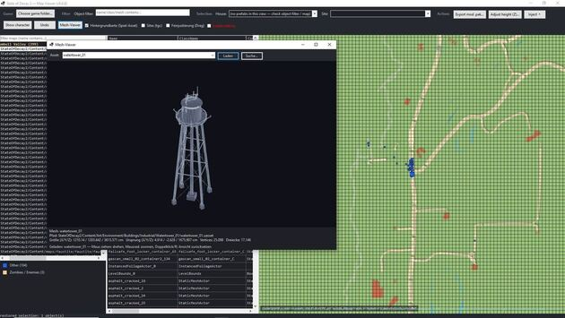

# SoD2MapV — State of Decay 2 Map Viewer und Editor

Nativer Windows-Map-Viewer/-Editor für **State of Decay 2** (UE4) — C# / WinForms + [CUE4Parse](https://github.com/FabianFG/CUE4Parse). Liest alle Spielmappen ohne AES-Key, zeigt sie top-down, editiert Objekte und injiziert Fahrzeuge & Items in Live-Savegames.

<a href="https://www.buymeacoffee.com/Orohal" target="_blank"></a>

**Aktueller Stand: [v0.7.2](https://github.com/Orohal/SoD2MapV/releases/latest)** - Viewer + Voll-Editor + History + Bearbeitungs-Farben (rot/grün) + Fahrzeug- & **Item-Injektion** (GUI/CLI, Presets aus Save, persistent) + **Häuser/Objekte & Sites verschieben** (Gruppen-Auswahl, Undo, **Chunk-Patch-Export** für spielwirksame Tile-Mods, **Auto-Multi-Map**: Tile + `<region>_sites.umap` automatisch in einem Patch) + **Höhenanpassung (Z)** + **versetzte Sites vollständig claimbar im Spiel** (Tag-DB-Patch + Kind-Actor-Frame-Fix, ingame verifiziert) + **Plattform an Spieler-Position injizieren** (30×30-m-Betonplattform per Klick an die Save-Position, dichte-basierte Kachelwahl, ingame verifiziert; `--injectplatformauto`/`--patchsmc`) + **regionweite Site-Auswahl** (Klick auf den Regions-Knoten in der Map-Liste listet alle Sites aller Tiles; Auswahl lädt die Tile automatisch) + **Neue Gruppe** (Kopie einer Community mit neuer Identität als eigenen Spielstand anlegen — ingame verifiziert; „Neue Gruppe…"-Button in beiden Inject-Dialogen, CLI `--saveclone`) + **Session-Wiederherstellung** + **Koordinaten-Fix** (Welt vs. Kachel-lokal für Spieler-Marker, Ansicht, Injektion) + **Funktion-Actoren** (Outpost-/Homesite-Interactables wandern mit dem Gebäude) + **eigene Vektor-Basemap** (offline, aus den Ingame-`MapBackgroundData`-Assets, alle 5 Regionen, automatisch verankert) + **tgc-Site/Outpostable-Overlay** (claimbare Gebäude an ihren echten Positionen, klickbar in Box **und** Name). + **Mesh-Viewer mit Asset-Suche** (GUI-Button, `--meshview`/`--meshsearch`: Meshes drehen/zoomen, Bounds in cm, Batterie an Karten-Assets) + **umschaltbare Sprache DE/EN** (JSON-Wörterbücher neben der EXE, Umschalter startet den Viewer neu) + **Favoriten-Panel** unten (Karten/Objekte markieren, Doppelklick lädt/selectet; Größen des Bereichs ziehbar) + **Plattform-Mesh-Override-Fallback** (wenn keine scale-fähigen Slab-Actoren existieren: eindeutig verwendetes Mesh im Mod-Pak überschreiben) + **Modus-Abwahl** (M/R/S nochmal = aus) + **P** (Figur anzeigen) / **V** (Mesh-Viewer). Details: [Repo-Status](#repo-status--versionshistorie) (eingeklappt).


## Features

- **890 Karten** aus allen 35 PAKs, fehlerfrei lesbar (eigener LZ4-Linked-Blocks-Decoder)
- **2D-Top-Down-Viewer**: Objekte mit Positionen; Grid, Suchfilter, Legende
- **Voller Editor**: verschieben / rotieren / skalieren / löschen per Drag & Drop, Undo, Export als Mod-`.pak`
- **Haus-Gruppen verschieben**: Rechtsklick auf ein Haus (oder Auswahl im **„House:"**-Dropdown) wählt Haus-Prefab + alle Objekte im 40-m-Umkreis als Gruppe, gemeinsamer Drag, Undo, Export als Mod-`.pak` (Autofit auf die Auswahl)
- **Plattform an Spieler-Position injizieren** (ab v0.6.6): Menü **Inject ▾ → „Plattform an Spieler-Position…"** — flache Betonplattform (Standard 30×30 m; Größe, Yaw und Höhenoffset einstellbar) an der zuletzt gespeicherten Spielerposition; Kachelwahl automatisch per Actor-Dichte, Boden-Höhe robust geschätzt (Median gefilterter Nachbar-SMCs), Roundtrip-Verifikation, Mod-`.pak` erzeugen oder nutzerbestätigt ins Spiel installieren. **Ingame verifiziert.**

<details>
<summary><b>Echte Karte als Hintergrund</b></summary>

- **Vektor-Basemap** aus den Ingame-`MapBackgroundData`-Assets (Straßen/Flüsse/Seen/Gebäude/Border), offline, alle 5 Regionen, per Drag kalibrierbar

</details>

<details>
<summary><b>Fahrzeug-Injektion in Live-Savegames</b></summary>

- Rechtsklick auf der Karte → Position → Fahrzeug in Save schreiben
- Per-Save-Kalibrierung, Auto-Backup, Spiel-läuft-Check

</details>

<details>
<summary><b>Item-Injektion in Live-Savegames</b></summary>

- Dialog „Inject item…" (Menü **Inject ▾**) — Item-Stacks in den Rucksack eines Überlebenden
- **Item-Presets automatisch aus dem gewählten Save** abgeleitet (z. B. Benzinkanister, Reparaturkasten, Waffen wie Assault_FAL)
- Backup + Self-Check; CLI `--saveitems` / `--saveitemlist`

Was beim Injizieren passiert (pro Item):

- Item-Klasse wird in der **ItemLibrary** des Saves ergänzt, falls sie dort noch nicht existiert
- Eine Item-Instanz wird aus dem letzten vorhandenen Eintrag desselben Typs geklont (volle Eigenschaften wie Klassenvorlage/Werte bleiben erhalten)
- Ein **ItemOrder**-Eintrag wird angehängt und ein **freier Inventar-Slot** im Rucksack des Ziel-Überlebenden belegt
- Ziel-Überlebender: beliebige Survivor-ID oder `-1` = **zuletzt gespielter** Überlebender (`LastPlayedSurvivorID`); es werden so viele freie Slots benötigt, wie Items injiziert werden

</details>

- **Mini-Mesh-Viewer**: softwaregerendertes 3D-Preview (Orbit/Zoom, Bounds in cm, Vertex/Triangle-Count) für `UStaticMesh`/`USkeletalMesh` inkl. Blueprint-Fallback; **„Suche..."** durchsucht alle gemounteten Assets (GUI) — headless: `--meshview <gameDir> <asset> <out.png>` und `--meshsearch <gameDir> <filter> [limit]`
- **Sprache DE/EN**: Button „🌐 DE/EN" in der Toolbar; die Wörterbücher `lang_de.json`/`lang_en.json` liegen neben der EXE und sind ohne Rebuild editierbar. Der Viewer startet beim Wechsel automatisch neu.
- **Favoriten**: Checkboxen in der Kartenliste + „★ Favoriten"-Menü in der Objekt-Tabelle (markieren/entfernen/nur Favoriten/Namen kopieren); das **Favoriten-Panel** unten listet alles zentral (Doppelklick lädt die Karte bzw. selektiert das Objekt). Panelhöhe per Splitter ziehbar.
- **History & Bearbeitungs-Farben**: Das **History-Panel** unten (neben den Favoriten) protokolliert chronologisch, was gemacht wurde — `HH:mm:ss  move/rotate/scale/delete: Objekt von → nach` (bis 200 Einträge, in `session.json` persistiert). In der **Kartenliste** sind bearbeitete `.umap`s **rot**, unbearbeitete **grün** — man muss nicht mehr raten, welche Map schon angefasst wurde. Markierung bleibt über Neustart und Kartenwechsel erhalten.
- **Bedienung**: Modus-Buttons und `M`/`R`/`S` sind abwählbar („Aus"), `P` zeigt die Spielerposition, `V` öffnet den Mesh-Viewer; „? Hilfe" listet alle Kürzel.
- **Plattform-Fallback**: Fehlen scale-fähige Boden-Actoren, wird ein eindeutig verwendetes Mesh (`asphalt_slab_01`, ~14,8 × 14,8 m) im Mod-Pak überschrieben und nur der Actor verschoben — inklusive Pfad-/Parent-Chain- und Bounds-Prüfung.
- Headless-CLI für alle Funktionen (siehe unten)

## Update-Prüfung (Variante A)

Der Viewer kann beim Start auf GitHub prüfen, ob eine neuere Version vorliegt
(`Releases → Latest`). Das lässt sich im Dialog **„Update?"** (Toolbar) über die
Checkbox **„Beim Start nach Updates suchen"** ein- und ausschalten; dort kann man
auch manuell prüfen und die Release-Seite im Browser öffnen.

- **Kein Download, kein Self-Replace, keine Dateiänderungen** — nur Anzeige und Link.
- Bei Offline/API-Fehler: stille Meldung im Dialog, kein Absturz, kein Retry-Sturm.
- Die Prüfung nutzt HTTPS und strikt die GitHub-REST-API; der geöffnete Link wird
  auf `github.com/Orohal/SoD2MapV/releases` begrenzt.
- Einstellung wird in `session.json` gespeichert (`CheckUpdatesOnStartup`, Default `true`).

## To do

1. **Feinschliff / Polish:** Viele kleine Verfeinerungen, Bugfixes und UX-Polish; Fokus auf Stabilität, Konsistenz und Detailarbeit im Editor, Export und UI.
2. **Hintergrund-Ausrichtung der übrigen Regionen** — Faustite/Trumbull ist kalibriert (per Drag + Auto-Fit); für Cascade Hills, Drucker County, Meagher Valley, Providence Ridge und die Trumbull-Variante stehen Scale/Offset noch aus (Auto-Fit: `--bgfit`, Feinjustierung per Drag)

## Dokumentation

Ausführliche Anleitung (Viewer, Editor, Modding-Workflow, CLI, Fehlerbehebung) — auch als [GitHub-Wiki](https://github.com/Orohal/SoD2MapV/wiki):

- [Home / Übersicht](https://github.com/Orohal/SoD2MapV/wiki/Home)
- [Installation](https://github.com/Orohal/SoD2MapV/wiki/Installation)
- [GUI & Bedienung](https://github.com/Orohal/SoD2MapV/wiki/GUI)
- [Modding-Workflow (Objekte/Sites verschieben, PAK-Export)](https://github.com/Orohal/SoD2MapV/wiki/Modding-Workflow)
- [CLI (Headless-Modi)](https://github.com/Orohal/SoD2MapV/wiki/CLI)
- [Mesh-Viewer, Favoriten & Sprache](https://github.com/Orohal/SoD2MapV/wiki/Mesh-Viewer-und-Favoriten) (Quelle: [`docs/Mesh-Viewer-und-Favoriten.md`](docs/Mesh-Viewer-und-Favoriten.md))
- [Fehlerbehebung](https://github.com/Orohal/SoD2MapV/wiki/Troubleshooting)

Quelltext der Doku liegt zusätzlich in [`docs/`](docs/) im Repo.

## Voraussetzungen & Build

- [.NET 10 SDK](https://dotnet.microsoft.com/download/dotnet/10.0) (Windows), SoD2-Installation
- Fertige EXEs: [Releases](https://github.com/Orohal/SoD2MapV/releases) (framework-dependent; self-contained nur auf Anfrage)
- Bauen: `dotnet build app/SoD2MapViewer.csproj -c Release`

## Nutzung (GUI)

Starten → **Choose game folder** → Karte links wählen:

```sh
dotnet app/bin/Release/net10.0-windows/SoD2MapViewer.dll
```

**Editor:** Checkbox *Enable editing* → Objekt greifen und bearbeiten:

| Taste | Aktion |
|-------|--------|
| Drag | Objekt bearbeiten (je nach Modus) |
| `M` / `R` / `S` | Modus: Move / Rotate / Scale (nochmal drücken = Modus aus) |
| `P` | Figur/Spielerposition anzeigen |
| `V` | Mesh-Viewer öffnen |
| `Entf` | Objekt als gelöscht markieren |
| `Ctrl+Z` | Undo |
| `F` | Fit auf alle Objekte |
| Doppelklick | Zoom auf Cursor |
| Rechtsklick | Kontextmenü (Location kopieren, Modus, Delete) |

**Export mod .pak…** schreibt alle Änderungen als **Chunk-Patch** (`pakchunk<chunkId>-…_P.pak`) nach `…\StateOfDecay2\Content\Paks\` (das `_P`-Suffix gibt dem Mod den Vorzug; Chunk-Patches gehören in `Content\Paks`, nicht `Saved\Paks`).

<details>
<summary><b>Fahrzeug injizieren</b></summary>

Einmalig **Kalibrierung** (pro Save): Toolbar **„Inject vehicle…"** oder **Rechtsklick auf der Karte** → Slot/Klasse/Position prüfen → **Calibrate…** → Sonde ins Spiel, beobachteten Versatz (Ost/Nord in m) im Dialog eingeben → Fertig. Danach injizieren echte Fahrzeuge exakt an der gewählten Stelle.

- Vor jedem Schreiben: Spiel muss geschlossen sein + automatisches Backup unter `Backups\`
- Sonden-Fahrzeuge: „Delete probe vehicle"
- Kalibrierung persistiert: `%LOCALAPPDATA%\SoD2MapViewer\calibration.json`

**Schnell: „Inject at player“ (ab v0.5.3):** Zuerst **„Show character"** klicken (liest die zuletzt gespeicherte Spielerposition aus dem Save, `PlayerBreadcrumbs`, nutzt die Save-Kalibrierung) → dann **„Inject at player"**. Der Injekt-Dialog wird mit Spieler-Pos/Höhe (+10 m Offset) vorausgefüllt. **Hinweis:** Möglichst auf einer **freien Fläche** stehen, sonst kann das Fahrzeug in einem Objekt spawnen. Die Blickrichtung ist aus dem Save nicht ablesbar — **Yaw/Position/Höhe** im Dialog bei Bedarf anpassen. Zahlenfelder akzeptieren `,` oder `.`; leere Z-/Shift-/Yaw-Felder = `0`.

**Neue Gruppe (ab v0.6.5):** Button **„Neue Gruppe…"** im Inject-Dialog klont das gewählte Save unter dem nächsten freien Slot-Namen (`SaveGame_Vanilla_3.sav` usw.) und schreibt die Identitäts-GUIDs (`ID`, `GameId`) neu — das Spiel sieht die Kopie als **eigene Community** (ingame verifiziert). Der Klon wird sofort ausgewählt, sodass Fahrzeuge direkt reininjiziert werden können. Existierende Ziele werden nie überschrieben; bei fehlgeschlagenem Self-Check wird die Datei wieder gelöscht. CLI: `--saveclone`.

</details>

<details>
<summary><b>Item injizieren</b></summary>

Menü **Inject ▾** → **„Inject item…"**: Save wählen (automatisches Backup, Spiel muss geschlossen sein, danach Self-Check) → Ziel-Überlebenden wählen (Default: **zuletzt gespielter**) → Item(s) setzen.

- **Presets** (z. B. Benzinkanister, Reparaturkasten) sind vorbereitet und werden **automatisch aus dem gewählten Save abgeleitet** — die Liste enthält nur Item-Klassen, die es in diesem Save wirklich gibt (Typ + Klassenpfad)
- Manuelle Eingabe möglich: Item-Klassenpfad + Stack-Anzahl; **StackCount ist bei Waffen optional** (Waffen werden über eine klassenbezogene Vorlage injiziert, Stacks über Zahl-Feld)
- Es werden freie Rucksack-Slots im Ziel-Überlebenden benötigt (einer pro Item); fehlen sie, bricht der Vorgang sauber ab
- CLI-Äquivalent: `--saveitems` (injizieren), `--saveitemlist` (Item-Klassen des Saves auflisten)
- **„Neue Gruppe…"** (ab v0.6.5, wie im Fahrzeug-Dialog): Save mit neuer Identität klonen und Items direkt in die frische Gruppe injizieren

</details>

<details>
<summary><b>Echte Karte als Hintergrund</b></summary>

Toolbar **„Hintergrundkarte (Spiel-Asset)"** — blendet die eigene Vektor-Karte aus den Ingame-`MapBackgroundData`-Assets (`StateOfDecay2/Content/maps/Backgrounds/*`) ein: Straßen, Flüsse, Seen, Gebäude und die Karten-Grenze, in den echten Ingame-Farben (`MapUIInfo_BP`). Komplett offline, für alle 5 Regionen, automatisch am Tile-/World-Offset verankert. Checkbox **„Sites (tgc)"** zeichnet zusätzlich die claimbaren Site-/Outpostable-Boxen aus der Region-tgc an ihren echten Positionen. Die Boxen sind **klickbar** (wählen alle Objekte der Site aus, danach Drag in der Box) und per **„Site:"-Dropdown** wählbar (Name + GUID-Kürzel). Bei Abweichung: Checkbox **„Feinjustierung (Drag)"** einschalten und die Karte per Drag ausrichten (Loslassen übernimmt die Kalibrierung und zeigt ox/oy an). CLI: `--bgrender` (PNG-Render), `--bgprops` (Asset-Properties), `--bgfit` (automatische Kalibrierung gegen tgc-Site-Boxen), `--bgset` (manuelle Transform-Werte).

</details>

<details>
<summary><b>Headless-Modi (CLI)</b></summary>

```sh
# Alle 890 Karten parsen und Erfolg/Fehler zusammenfassen
SoD2MapViewer.exe --smoke-all "D:\Games\State of Decay 2\StateOfDecay2"

# Die ersten Karten parsen und Objekte mit Positionen ausgeben
SoD2MapViewer.exe --smoke "D:\Games\State of Decay 2\StateOfDecay2"

# Low-Level-Diagnose eines einzelnen Pak-Eintrags (Codec-Tests pro Block)
SoD2MapViewer.exe --diag "D:\Games\State of Decay 2\StateOfDecay2" "StateOfDecay2/Content/maps/trumbull_valley/trumbull_valley/trumbull_valley_x0_y0.umap"

# Pak-Struktur eines .umap-Files analysieren (Summary, Imports, Exports + Name-Map-Sidecar <file>.names.txt)
SoD2MapViewer.exe --umapinfo "D:\Games\State of Decay 2\StateOfDecay2" <file.umap> [exportFilter] [hexOff] [hexLen]

# Tagged Properties eines Exports byte-exakt dekodieren (FName-Auflösung, Tag-Offsets, Trailer-Bytes)
SoD2MapViewer.exe --umapdecode "D:\Games\State of Decay 2\StateOfDecay2" <file.umap> <exportIndex0based>

# Synthetische 200x200-m-Testmap erzeugen: flacher Boden (WaterPlane_01, Scale 20) + 9 Grid-Marker
# mit bekannten Positionen/Yaws/Scales — nur für Viewer/Editor-Tests, nicht für das Spiel bestimmt
SoD2MapViewer.exe --genmap <out.umap>

# Testmap end-to-end validieren (Pak bauen → ParseMap → Transform-Check gegen Sollwerte);
# mit gameDir wird sie zusätzlich als pakchunk997-WindowsNoEditor_P.pak installiert (Datei löschen zum Revert)
SoD2MapViewer.exe --testmap <file.umap> ["D:\Games\State of Decay 2\StateOfDecay2"]

# Dekomprimierten Savegame-Block parsen: Top-Level-Props, VehicleSaveCollection; optional Props eines Eintrags dumpen
SoD2MapViewer.exe --saveprops <file.gvas> [entryIndex]

# Fahrzeug in die VehicleSaveCollection injizieren: klont einen bestehenden Eintrag, patcht Klasse/Transform.
# Koordinaten in UE-cm, yaw in Grad, templateIndex = zu klonender Eintrag (-1 = erster lebender), setGuid=1 = frische GUID
SoD2MapViewer.exe --saveinject <save.sav> <out.sav> <classIndex> <x> <y> <z> [yaw] [templateIndex] [setGuid]

# Fahrzeugeinträge per Index löschen (Bereiche "24-56" oder Liste "24,27")
SoD2MapViewer.exe --savedelete <save.sav> <out.sav> <indexSpec>

# Item-Klassen aus der ItemLibrary des Saves auflisten (Ausgabe: <itemType>\t<classPath>; optional Filter auf Typ oder Pfad)
# -> liefert die gültigen <itemType>-Werte und <classPath>s für --saveitems
SoD2MapViewer.exe --saveitemlist <save.sav> [filter]

# Item-Stacks in den Rucksack eines Überlebenden injizieren: pro Item ein Paar <classPath> <stack>.
# <itemType> = Typ-Präfix aus der Save-ItemLibrary (z. B. Weapon, Resource, Consumable — siehe --saveitemlist);
# <survivorId> -1 = zuletzt gespielter Überlebender (LastPlayedSurvivorID); pro Item wird ein freier Inventar-Slot benötigt.
# Schreibt <out.sav>, das Eingabe-Save bleibt unverändert.
SoD2MapViewer.exe --saveitems <save.sav> <out.sav> <survivorId> <itemType> <classPath1> <stack1> [<classPath2> <stack2> ...]

# "Neue Gruppe": Save unter dem nächsten freien Slot-Namen klonen (z. B. SaveGame_Vanilla_2 -> SaveGame_Vanilla_3.sav)
# und die Identitäts-GUIDs (ID, GameId) neu schreiben — das Spiel sieht die Kopie als eigene Community.
# Weltzustand (Fahrzeuge, Items, Base) bleibt erhalten; Self-Check inklusive; existierende Ziele werden nie überschrieben.
SoD2MapViewer.exe --saveclone <save.sav> [dst.sav]

# Live-Savegames auflisten (%LOCALAPPDATA%\StateOfDecay2, neueste zuerst)
SoD2MapViewer.exe --saves

# Spielerposition aus dem Save lesen (cm + Archetyp)
SoD2MapViewer.exe --playerpos <save.sav>

# Mesh-Viewer headless: MeshesRepository-Pfad oder Kurzname, shaded PNG + Bounds (cm) auf stdout
SoD2MapViewer.exe --meshview "<gameDir>" asphalt_slab_01 out.png [yawDeg] [pitchDeg]

# Asset-Suche über alle gemounteten Pak-Dateien (z. B. antenna, wall, tower)
SoD2MapViewer.exe --meshsearch "<gameDir>" tower 40

# Bestehenden Actor-Component in-place patchen (1-basierter Export-Index; nur RelativeLocation/
# RelativeRotation/RelativeScale3D werden überschrieben — bewährt für Teleport/Scale-Mods)
SoD2MapViewer.exe --patchsmc <in.umap> <out.umap> <export1> <x> <y> <z> [pitch yaw roll] [sx sy sz]

# Gepatchte .umap als Mod-Pak bauen (Entry-Pfad MUSS das "maps/"-Präfix enthalten,
# sonst wird die Datei unter einem zweiten, unbenutzten Asset-Pfad abgelegt)
SoD2MapViewer.exe --packumap <in.umap> <out.pak> maps/<region>/<region>/<tile>.umap

# Roundtrip-Verifikation (Ergebnis muss byte-identisch sein)
SoD2MapViewer.exe --umaproundtrip <file.umap> <out.umap>

# Plattform-Injektion headless: Spielerposition lesen, Kachel per Actor-Dichte wählen, Betonplattform
# in eine scale-fähige SMC patchen (Standard 30x30 m, +50 cm über Boden), Roundtrip prüfen, Pak erzeugen
SoD2MapViewer.exe --injectplatformauto "<gameDir>" [savePath] [sizeM] [yawDeg] [heightCm] [outPak]
```

</details>

<details>
<summary><b>Technik</b></summary>

| Baustein | Umsetzung |
|---|---|
| GUI | C# / WinForms (`net10.0-windows`) |
| Pak-Mounting & Asset-Parsing | [CUE4Parse](https://github.com/FabianFG/CUE4Parse) (`EGame.GAME_StateOfDecay2`) |
| LZ4 Linked Blocks | eigener sequenzieller Decoder (`app/Lz4Linked.cs`) — SoD2 nutzt LZ4-„Linked Blocks" (Rückverweise in die unkomprimierte Ausgabe des Vorgängerblocks); CUE4Parse dekodiert isoliert und scheitert daran. Damit: alle 890 Karten lesbar (`--smoke-all: ok=890 failed=0`) |
| Karten-Objekte | Actors via `RootComponent` → `Transform` (Fallback: `RelativeLocation`/`RelativeRotation`/`RelativeScale3D`) |
| Vektor-Basemap | Ingame-`MapBackgroundData`-Assets (Straßen/Flüsse/Seen/Gebäude/Border), gerendert in `MapUIInfo_BP`-Farben (`app/BgMaps.cs`) — komplett offline |

</details>

<details>
<summary><b>Repo-Status / Versionshistorie</b></summary>

- **v0.7.2** - **Update-Prüfung + Audit-Fixes**: Neuer Dialog **„Update?"** in der Toolbar — prüft den neuesten GitHub-Release (HTTPS, 4 s Timeout, ohne Download/Self-Replace) und zeigt Version + Release-Link. Checkbox **„Beim Start nach Updates suchen"** (in `session.json`, Default an); bei Offline oder aktueller Version bleibt es still. Zusätzlich aus zwei Audits: atomare Savegame-/Session-Schreibvorgänge mit Backup und Rollback, Patch-Fehler als Dialog statt Statuslog, Overlay-Threading auf `std::atomic`, TOCTOU-freier Speicher-Scan, konsistente CLI-Fehlercodes, PerMonitorV2-DPI, Debug-Logging statt stiller Catcher, SelfTest-Projekt (19 Checks) und diverse Performance-/AufräumFixes.
- **v0.7.1** - **History & Bearbeitungs-Farben**: Neues **History-Panel** unten (neben den Favoriten) protokolliert chronologisch alle Edits — `HH:mm:ss  move/rotate/scale/delete: Objekt von → nach` (bis 200 Einträge, in `session.json` persistiert, übersteht Neustart). In der **Kartenliste** werden bearbeitete `.umap`s **rot**, unbearbeitete **grün** angezeigt (`HashSet<string> _modifiedMaps`, gefüttert bei jeder Editierung, persistiert als `SessionState.ModifiedMaps`) — kein Raten mehr, welche Map angefasst wurde. Mit echten Edits im GUI verifiziert (5 Moves + 2 markierte UMaps in der Session).
- **v0.6.9** - **Fix: Mod-Pak-Einträge für Plattform-Injektion**: `DerivePakEntryPath` hatte das `maps/`-Präfix entfernt — der gepatchte Tile landete unter einem zweiten, ungenutzten Asset-Pfad und wurde nie geladen. Jetzt bleibt der Pfad korrekt (`maps/faustite/faustite/…`); mit `--where` verifiziert (Patch kommt aus dem Mod-Pak statt aus dem Vanilla-Chunk) und ingame getestet.
- **v0.6.8** - **DE/EN-Sprachumschalter, Favoriten-Panel, Plattform-Fallback, UX-Details**: umschaltbare UI-Sprache über `lang_de.json`/`lang_en.json` mit automatischem Neustart; Favoriten-Panel unten (Karten/Objekte, Doppelklick, ziehbar); Mesh-Override-Fallback für Karten ohne scale-fähige Slab-Actoren (Pfad/Kollision/Bounds/Parent-Chain abgesichert, Review bestanden); „Figur anzeigen" hervorgehoben + `P`, Mesh-Viewer `V`, Modi abwählbar, dunkle Menüs/Dialoge, lesbares Canvas-HUD, `CellFormatting`-Fix für die Objekt-Tabelle.
- **v0.6.7** - **Mini-Mesh-Viewer + Asset-Suche**: GUI-Dialog mit Software-3D-Render (Orbit/Zoom/Bounds), `--meshview`/`--meshsearch` CLI, Preset-Set; dazugehörige Kalibrierungen/UI-Fixes.
- **v0.6.6** - **Plattform an Spieler-Position injizieren + In-Place-SMC-Patching (ingame verifiziert)**: Menü **Inject ▾ → „Plattform an Spieler-Position…"** platziert per Klick eine flache Betonplattform (Standard 30×30 m; Größe/Yaw/Höhenoffset einstellbar, Default **+50 cm** über Boden) an der zuletzt gespeicherten Spielerposition. Kachelwahl **dichte-basiert** (SMC-Nähe um das Ziel im bewiesenen Identitäts-Frame `world_save = RelLoc + WorldTileInfo.Position`), Boden-Höhe robust via **Median gefilterter Nachbar-SMCs** (±5-m-Plausibilitätsband um die Save-Z), Kandidatenwahl auf >150 m entfernte scale-fähige SMCs mit erlaubten Boden-Meshes (`concrete_slab_01`/`asphalt_cracked_01`), Mesh-Bounds live aus den Game-Assets. Patch nur von RelativeLocation/RelativeRotation/RelativeScale3D, **Roundtrip-Verifikation byte-identisch**, Pak-Erzeugung + nutzerbestätigte Installation. Ingame verifiziert: Plattform sichtbar, Character wird auf sie gesetzt. CLI: `--injectplatformauto`, `--playerpos`, `--patchsmc`, `--umaproundtrip`, `--packumap`. GUI: Actor-Punkte in der Kartenansicht deutlich lesbarer (sattes Blau, 5-px-Minimum, dunkle Kontur).
- **v0.6.5** - **Neue Gruppe (Kopie + Identität, ingame verifiziert)**: Ein Save wird unter dem **nächsten freien Slot-Namen** geklont (`SaveGame_Vanilla_2` → `SaveGame_Vanilla_3.sav`) und die **Identitäts-GUIDs (`ID` + `GameId`) neu geschrieben** — das Spiel behandelt die Kopie als **eigene, spielbare Community** (im Spiel verifiziert). Weltzustand (Fahrzeuge, Items, Base) bleibt erhalten. **„Neue Gruppe…"**-Button in beiden Inject-Dialogen (Klon wird sofort ausgewählt, direkt reininjizierbar), CLI `--saveclone <save.sav> [dst.sav]`. Fail-safe: Self-Check (Reparse, GUID-Vergleich, Fahrzeuganzahl) — bei Fehlschlag wird die geschriebene Datei wieder gelöscht; existierende Ziele werden nie überschrieben. Bugfix: doppelte `_btnCopySave.Click`-Registrierung im Item-Inject-Dialog entfernt (Handler lief pro Klick zweimal).
- **v0.6.4** - **Regionweite Site-Auswahl + persistente Item-Presets + Toolbar-Organisation**: Klick auf einen **Regions-Knoten** in der Map-Liste listet **alle Sites der Region** über alle Tiles (Label mit Tile-Name, aus den tgc-Entity-Pfaden abgeleitet); Auswahl einer fremden Tile lädt diese automatisch und springt zur Site. **Persistente Item-Presets** in `%LOCALAPPDATA%\SoD2MapViewer\item_presets.json`: „Preset speichern/löschen" im Inject-Dialog, **„Presets aus allen Saves"** scannt alle Savegames und legt fehlende Item-Klassen als Presets an (Cross-Save-kompatibel). **Toolbar** in vier logische Gruppen gegliedert (Game | Filter | Selection | Actions), „Enable editing" rechts neben „Feinjustierung (Drag)" mit rotem Label. Preset-Dropdowns alphabetisch sortiert.
- **v0.6.3** - **Versetzte Sites vollständig claimbar (ingame verifiziert)**: Das Kind-Actor-Problem von v0.6.2 ist gefixt — Türen, Claim-Terminals und Container hängen als Kind-Aktoren an einem (um Yaw gedrehten) Gebäude-Prefab und speichern ihre Transforms **relativ zu dessen lokalem Frame**. Der Export schrieb bisher den Welt-Delta roh hinein (doppelte Bewegung + Rotation-Smear → Terminal landete ~300 m daneben). Jetzt erkennt der Export mitgezogene Kinder und lässt deren relative Transforms **unverändert** (sie folgen dem Prefab automatisch); einzeln verschobene Kinder bekommen ihren Delta korrekt in den Owner-Frame rotiert. Der Export-Dialog meldet die Anzahl der mitgeführten Kind-Aktoren. Carried-Erkennung robust gegen Float32-Auslöschung bei Kachel-Koordinaten (~10⁵ cm). BUGFIX-Paket: Nullability-Warnungen in `TgcPatcher`/`Smoke` bereinigt.
- **v0.6.2** - **Cooked-Tag-Datenbank-Patch**: Das Spiel liest Runtime-Sites/Interactables/Container aus **`Tagged/Cooked/<region>_Tags.uasset`** (`TaggedDatabaseAsset.Database`), nicht aus der compiled JSON (`.tgc`). Der Export patcht jetzt **beide** Tag-Datenbanken im Chunk-1095-Pak (JSON + Cooked-Asset, bytegenaue X/Y/Z-Tripel-Shifts, auch bei unaligned Daten); Meldung `cooked asset: N position(s) shifted, M not found` im Export-Dialog. Ingame-Status: Meshes wandern korrekt, Laufzeit-Site-Actoren hingen noch an der alten Position (gefixt in v0.6.3).
- **v0.6.1** - **Site-Name klickbar & Auto-Multi-Map**: Das gezeichnete **Site-Label** (z. B. „Autoshop") ist klickbar wie die Box (wählt alle Objekte der Site). **Automatische Multi-Map-Erkennung**: Verschiebt eine Site ihren `TaggedSitePrimaryBuildingMarker`, patcht der Editor die passende Regions-Sites-Map (`faustite_sites.umap` usw., Match über exakte Weltposition <1 cm) **automatisch in denselben Pak** — manuelles Multi-Map-Workflow (Checkbox + „Finalize Export") entfällt und wurde entfernt. Bugfixes: **tgc-Yaw** wurde als Radiant interpretiert (6302° statt 110°) → Boxen/Hit-Test korrekt rotiert; **Site-Dropdown** sortiert alphabetisch, zeigt Objektanzahl, nur Sites mit Objekten, Mehrfachauswahl derselben Site möglich (`SelectionChangeCommitted`). Ingame-Status: Meshes wandern korrekt, **Laufzeit-Site-Actoren (Claim/Türen/Container) noch nicht** (To-do 1).
- **v0.6.0** - **Site-Auswahl & -Verschiebung per Klick/Name**: Die orange/blaue tgc-Site-Boxen sind **klickbar** — ein Klick in eine Box wählt alle Objekte der Site aus (inkl. Owner-gebundener Outpost-/Homesite-Interactables); danach **Drag in der Box** verschiebt die ganze Gruppe (Undo per Button/Strg+Z). Neuer **„Site:"-Dropdown** listet die Sites des Tiles (z. B. `OUT Autoshop (84D09511)`) und wählt per Name aus (Ansicht springt zur Site). Die Box wandert beim Drag **live mit** (Anzeige). Beim Export greift der tgc-Patch (`pakchunk001095`), der Site-Boxen/Marker/Entitäten mit demselben Delta verschiebt — die Claim-Position folgt dem Gebäude. Neue **„Undo"-Schaltfläche** in der Toolbar.
- **v0.5.9** - **Hintergrundkarte neu aufgebaut (einzelne Vektor-Karte, automatisch verankert)**: nur noch die Spiel-Asset-Vektorkarte (`MapBackgroundData`), klar identifiziert (Region/Asset/Verankerung im Overlay + Statuszeile), automatisch am Tile-/World-Offset verankert; Fandom-Basemap aus UI/Render/Drag entfernt; Faustite-Rotation/Mapping und Culling-Fixes. **tgc-Site/Outpostable-Overlay**: claimbare Gebäude/Site-Boxen aus der Region-tgc werden an ihren echten Positionen auf der Karte gezeichnet (Checkbox "Sites (tgc)"), passend zur automatischen Verankerung. **Kalibrierung Faustite** neu (Scale 1.0, nutzerkalibriert per Drag). GUI: Toolbar umbrechend, "Feinjustierung (Drag)" erreichbar, MessageBox mit übernommenen ox/oy. Build: 0 Fehler.
- **v0.5.8** - **Multi-Map-Export**: Checkbox **„Multi-Map“** + Button **„Finalize Export (N)“** kombinieren mehrere gepatchte Maps in **einen** Chunk-Patch (`pakchunk<id>-WindowsNoEditor_P.pak`). Hintergrund: die Ingame-Kartenanzeige eines Outposts hängt am `TaggedSitePrimaryBuildingMarker` in `<region>_sites.umap`, der Claim-Prompt am `OutpostInteractable_C` im Tile — beide Maps müssen in **einem** Patch landen (Workflow: „Multi-Map“ anhaken → Sites-Map bearbeiten → Export → Tile-Map bearbeiten → Export → Finalize). Gleiche Map ersetzt einen vorhandenen Pending-Eintrag; Edit-Flags werden nach dem Hinzufügen zurückgesetzt. GUI-Fix: Checkbox-Lesbarkeit im Dark-Theme.
- **v0.5.7** — **Koordinaten-Raum-Fix + Funktions-Actoren:** Spieler-Marker, Ansichtszentrierung und Rechtsklick-Injektionspunkt werden jetzt im Kachel-lokalen Raum gezeichnet (Welt → lokal über Tile-Offset); zuvor wurden Welt-Koordinaten in den Kachelraum geschrieben, was beim Ziehen von Objekten auf den Spieler-Marker zu falschen Ingame-Positionen führte. **Outpost-/Homesite-Interactables** (`OutpostInteractable_C`, `HomesiteInteractable_C`) sind jetzt über die `Owner`-Referenz mit ihrem Gebäude-Prefab verknüpft und wandern beim Ziehen (sowie bei „Adjust height (Z)…“) automatisch mit dem Gebäude mit (inkl. Undo/Export). Bugfix: Delta der verknüpften Actoren wird absolut (nicht mehr pro Mouse-Move kumulativ) angewendet. Hinweis: Ob das claimbare Outpost im Spiel funktioniert, hängt zusätzlich von der Site-Mechanik (Save-Site-Registrierung) ab; das Verschieben der Interactables ist Voraussetzung.\n- **v0.5.6** — **Tile-Verschiebungen spielwirksam**: Map-Edits werden als **Chunk-Patch** exportiert (`pakchunk<chunkId>-WindowsNoEditor_P.pak` nach `…\StateOfDecay2\Content\Paks`, z. B. Faustite = 004600), damit SoD2 die geänderten Tiles tatsächlich lädt. **Höhenanpassung (Z):** Button „Adjust height (Z)…“ verschiebt die Auswahl/Haus-Gruppe in der Höhe (Meter, Undo) — behebt Schweben/Versinken am Ziel. **Spielerhöhe im Marker:** „Show character“ zeigt Z auch am Karten-Marker. **Session-Wiederherstellung:** letzter Spielordner, Map, Filter und Auswahl werden gemerkt (`%LOCALAPPDATA%\SoD2MapViewer\session.json`). Hinweis: Tile-Chunk-Patches gehören nach `Content\Paks` (nicht `Saved\Paks`).
- **v0.5.5** — **Komplette Häuser verschieben**: Rechtsklick auf ein Haus (oder Auswahl im neuen **„House:"**-Dropdown) wählt das Haus-Prefab plus alle Objekte im 40-m-Umkreis als Gruppe, gemeinsamer Drag, Undo, Export als Mod-`.pak`. Strg+Klick / Shift+Drag-Box für Mehrfachauswahl. **Export-Fix**: Patcher sucht jetzt die Original-Koordinaten im pristinen Map-Bytes (Fix für verschobene Objekte). **Build:** 0 Warnungen (nullable/obsolete/API-Audit bereinigt). **Mod-Ordner korrigiert:** `%LocalAppData%\StateOfDecay2\Saved\Paks` (Steam/Epic).
- **v0.5.4** — **Item-Injektion & Savegame-Fixes**: GUI-Dialog „Inject item…" (im neuen **„Inject ▾"**-Menü) injiziert Item-Stacks in den Rucksack eines Überlebenden (Presets Benzinkanister/Reparaturkasten, **Item-Presets automatisch aus dem gewählten Save** abgeleitet/aktualisierbar, manuelle Eingabe, Backup/Self-Check). CLI: `--saveitems`, `--saveitemlist`. **Waffen-Injektion** gefixt (klassenbezogene Vorlage, `StackCount` optional). **Savegame-Parsing** robuster (`ByteProperty`-Enum-Namen, sized Arrays, `MapProperty`, Maskierung bogus High-Dword in Größenfeldern). README: Virenwarnung einklappbar.
- **v0.5.3** — **Spielerposition & vereinfachte Injektion**: Button „Show character“ zeigt die letzte Spielerposition aus dem Save (`PlayerBreadcrumbs`, mit Kalibrierung). „Inject at player“ füllt Pos/Höhe (+10 m Offset) vor und gibt Hinweis auf freie Fläche; Zahlenfelder akzeptieren `,`/`.` und leere Werte als `0`. **Fandom-Map verschiebbar** (nur zur groben Orientierung): „Edit base-map pos“ bei aktiver Fandom-/inaktiver Vektor-Map, Versatz gespeichert. **Vektor-Basemap-Fixes**: `faustite` nutzt `faustite_persistent_Background` (+180°) mit variantenspezifischer Kalibrierung; Kalibrierung asset-variantenfähig, Vektor standardmäßig an/über Fandom. CLI: `--bgrenderasset`.
- **v0.5.2** — **Map-Liste nach Regionen gruppiert**: unter „filter maps“ als ein-/ausklappbare Baumansicht (Trumbull Valley, Cascade Hills, Drucker County, Meagher Valley, Providence Ridge, Other); Filter expandiert Treffer-Gruppen.
- **v0.5.1** — **WeMod/Wand-Kachel-Map entfernt** (CDN-Abhängigkeit): Kachel-Layer, Tile-Projektion, `--wandcheck`/`--wandrender`/`--fancalib` sind weg; Regions-Konfigurationen und die Vektor-Basemap bleiben. Rebuild der Release-Artefakte.
- **v0.5.0** — **Eigene Vektor-Basemap (Option 2)**: rendert die Ingame-`MapBackgroundData`-Assets (`maps/Backgrounds/*_Background`: Road/River/Lakes/Building/Border-Buffer) direkt zu einer offline-Karte in den echten Ingame-Farben (`MapUIInfo_BP`) — für alle 5 Regionen. Widget↔Welt-Transform per Drag kalibrierbar („Edit base-map pos"), dazu CLI `--bgrender` / `--bgset`. Neue Tooling-Modi: `--maptex LIST/DUMP/PROPS/JSON` (Pak-Exploration). Fix: Trumbull-Kartenpfad (`maps/trumbull_valley/`) in der Regionserkennung. **Entfernt:** WeMod/Wand-Kachel-Hintergrund (CDN-Abhängigkeit) samt `--wandcheck`/`--wandrender`/`--fancalib`. Abhängigkeiten: `CUE4Parse-Conversion` 1.2.2.202611, `SixLabors.ImageSharp` 3.1.12. **Hinweis:** die Vektor-Map ersetzt die (ungenau kalibrierte) Fandom-Map als verlässliche Basis.
- **v0.4.2** — **Hintergrund für alle 5 Regionen** (faustite→Trumbull Valley, amethyst→Cascade Hills, basalt→Drucker County, copper→Meagher Valley, danburite→Providence Ridge — Zuordnung verifiziert über Sublevel-Namen + Render-Checks); Region wird automatisch aus dem Kartenpfad gewählt. Kachel-Zeichnung: grobe Ebene zuerst, Zoom klemmt auf die verlässlichen CDN-Ebenen z4/z5 (z1–z3 der WeMod-CDN sind lückenhaft), fehlende Kacheln werden aus der Elternebene hochskaliert gefüllt. Fix: Kachel-Cache mischte vorher Dateien verschiedener Regionen (Cache-Dateinamen sind jetzt pro Region/GUID — war Ursache des „Flecken/Löcher-Mosaiks"). CLI: `--wandrender`, `--tileinfo` (WorldTileInfo-Offsets je Region). **⚠ Rohbau-Hinweis:** die WeMod-CDN-Pyramide ist derzeit serverseitig unvollständig (Kacheln verschwinden/werden nachgeladen) — Löcher/Flecken im Hintergrund sind bis auf weiteres möglich; an der Anbindung wird weitergearbeitet (Community-Basemap als Fallback geplant)
- **v0.4.1** — **Wand-Hintergrund auto-ausgerichtet**: Kachel-Offset kommt aus dem UMAP-Header (`WorldTileInfo.Position`, pro Karte); keine manuelle Kalibrierung mehr (`--wandrender` ohne Offsets testbar)
- **v0.4.0** — Echte Karte als Hintergrund (Wand-Tiles, pixelgenaue Projektion, `--wandcheck`); Fenstertitel zeigt Paketversion; ungepackte Variante gegen Viren-FP
- **v0.3.5** — Framework-abhängiger Build als Release-Asset; `--saves`; Auto-Template-Injektion
- **v0.3.x** — **GUI-Injektion**: Rechtsklick → Fahrzeug in Live-Save (Kalibrierungs-Assistent, Auto-Backup, Spiel-läuft-Check, Sonden-Löschung); `--savedelete`
- **Voll-Editor (Phase 3)** — Move/Rotate/Scale/Delete mit Undo, Export als Mod-`.pak` (eigener Pak-Writer)
- **Savegame-Kalibrierung** (empirisch per Sonden-Fahrzeugen): `save = world + shift` (pure Translation, pro Save unterschiedlich); Koordinaten-Frames ingame bewiesen: `world_save = RelLoc + WorldTileInfo.Position` (Identität, reine Translation) und **+X = Nord, +Y = Osten** (−Y = Westen, Marker-Tests ingame verifiziert); **UE-Yaw positiv dreht +X (Nord) nach −Y (Westen)**, also gegen den Uhrzeigersinn (Vogelperspektive, Norden oben) — für Kompass-Drehrichtung (im Uhrzeigersinn) den Yaw-Wert negieren (Yaw-Marker-Test ingame verifiziert); Spiel kann schiefe Einträge ~20 m verschieben (Injektionspunkt auf freier Stellfläche wählen)
- **Basis-Lokalisierung**: faustite-Tile-Weltpositionen über `WorldTileInfo.Position` (x2y3: +496/−992 m); Workflow über `--umapinfo`/`--umapdecode` dokumentiert
- **Bugfixes**: Komponenten-Transform-Zuordnung (1-based `FPackageIndex`), `QuatFromRotator` UE-Konvention, `SetProperty`-Parsing (`SiteCollection`, 439 Sites), GUID-Arrays in `--umapdecode`
- Testmap-Generator (`--genmap`/`--testmap`) für Viewer-Tests ohne Spielinhalte

</details>

<details>
<summary><b>Virenwarnung / False Positive</b></summary>

Die gepackten Single-File-EXEs werden von einzelnen VirusTotal-Engines als generisch verdächtig gemeldet — bekanntes Muster für **unsignte** .NET-Apps („Packer"-Heuristik, kein echter Befund). Windows Defender meldet: **keine Bedrohung**.

**Wenn ungünstig:** Ordner-Variante ohne gepackte EXE nutzen — [SoD2MapViewer-framework-dependent-plain.zip](https://github.com/Orohal/SoD2MapV/releases/latest) (kleine EXE + DLLs, gleiche Funktion). Im eigenen Virenprogramm ggf. Ordner ausschließen.

**Published Hashes (SHA256) - v0.6.9:**

| Asset | SHA256 |
| --- | --- |
| `SoD2MapViewer-framework-dependent.zip` | `732BDB810FA15CB162F271E0CABEFA465E6C4A9E761BF54464C169BB3563F5C2` |
| `SoD2MapViewer-framework-dependent-plain.zip` | `A63DB43E0C0DCCC6B13369536BACBD0B8C1431C25BFD7E41527E5A8A4DA8B883` |
| `SoD2MapViewer.exe` (single-file, in framework-dependent.zip) | `F13FB2B91175C8BA8A1C4F0378182F3B2D9750D701E39BEA644D7FA61226870A` |
| `SoD2MapViewer.exe` (ungepackt, in plain.zip) | `696860C95F2CA3EC852DF7A3984F2AAF42F38E3E70B4411E51CD4D9607D284C5` |

Historisch: v0.5.7-Artefakte siehe [Release v0.5.7](https://github.com/Orohal/SoD2MapV/releases/tag/v0.5.7). Die framework-dependent Single-File-EXE von **v0.4.0** (`9FE1E0954E269916B67EB5937D45A0874A51CBEB964C0DD369382542FFDD6C2A`) wurde von 9 VirusTotal-Engines generisch gemeldet (Packer-Heuristik der Single-File-Apphosts).

- Selbst bauen: `dotnet build app/SoD2MapViewer.csproj -c Release` (self-contained nur auf Anfrage)
- False-Positive melden (alle Engines): [Microsoft WDSI-Filesubmission](https://www.microsoft.com/wdsi/filesubmission); bei anderen Engines jeweils deren FP-Portal nutzen

</details>

## Lizenz

MIT — siehe [LICENSE](LICENSE). Alle Markenrechte an *State of Decay 2* liegen bei Undead Labs / Microsoft.
